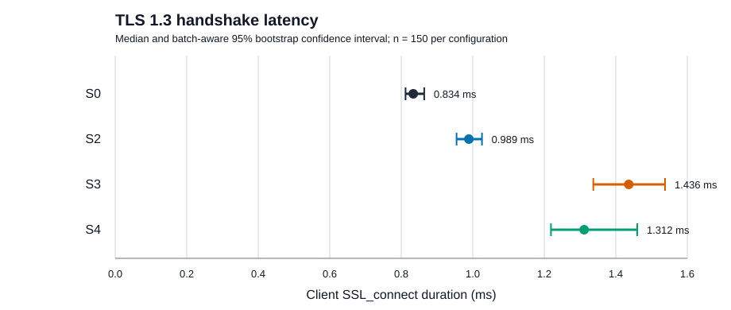
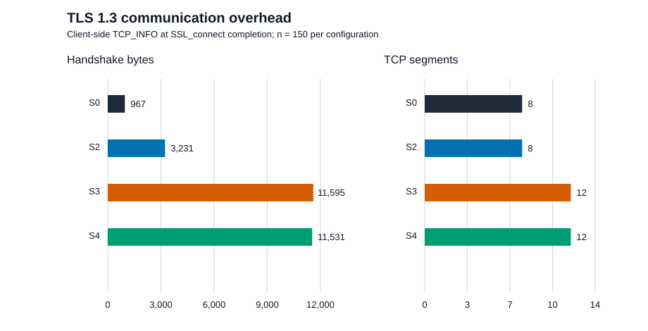
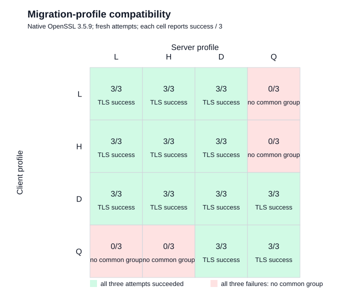
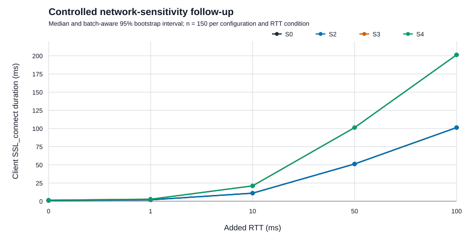

# From Classical to Post-Quantum: An Empirical Study of TLS Migration Paths, Performance Overhead, and Compatibility

## 5 Methodology

### 5.1 Study design and analytical scope

This work is a controlled empirical case study of selected TLS 1.3
configurations in native OpenSSL. It treats configuration behavior and
migration-path behavior as distinct analytical objects. Fresh-handshake
latency, communication descriptors, resource descriptors, and
same-configuration handshake outcomes are attributed to a configuration.
Configuration changes and profile compatibility are instead recorded as
properties of a transition path. This distinction avoids treating the
history-dependent work of migration as an intrinsic cost of a single
handshake.

The primary study was performed on native Ubuntu 26.04.1 running on an Intel
Core i5-12450H. It used OpenSSL 3.5.9 built from source commit
`45e844fa2a14ec92d146bd8f5778ac130b6625fb`. The scope is intentionally narrow:
the evidence concerns this pinned TLS 1.3/OpenSSL implementation, the stated
hardware and local credentials, and the controlled procedures described below.
It is not intended to estimate universal PQC performance, browser
interoperability, public-PKI behavior, or production deployment outcomes.

### 5.2 TLS configurations

All cases forced TLS 1.3 and `TLS_AES_128_GCM_SHA256`. Session tickets and
session caches were disabled. Each observation used a fresh client process and
a fresh server process configured to accept one connection. The four evaluated
configurations are listed in Table 1.

| Case | Key-establishment group | Server authentication |
| --- | --- | --- |
| S0 | X25519 | ECDSA P-256 |
| S2 | X25519MLKEM768 | ECDSA P-256 |
| S3 | X25519MLKEM768 | ML-DSA-65 |
| S4 | MLKEM768 | ML-DSA-65 |

**Table 1.** Evaluated TLS 1.3 configurations.

`X25519MLKEM768` is the hybrid TLS 1.3 key-establishment group standardized
by RFC 10024 [@RFC10024]. In contrast, S4 is described only as an
implementation-supported MLKEM768/ML-DSA-65 configuration in the pinned
OpenSSL build; it is neither labelled nor interpreted as a standardized hybrid
group. Before data collection, every configuration completed three independent
feasibility handshakes. A handshake was accepted only if the observed TLS
version, cipher suite, negotiated group, and CertificateVerify signature scheme
matched the requested configuration.

### 5.3 Primary Ubuntu campaign

The primary campaign contained five batches. In each batch, every case had ten
recorded warm-up handshakes followed by thirty measured fresh handshakes. The
warm-ups were retained as execution records but excluded from statistical
inference. The 120 measured handshakes within each batch were randomized over
the four cases using a recorded deterministic batch seed. The completed
campaign consequently comprised 200 warm-ups and 600 measured handshakes, or
150 measured observations per case.

The client and server were pinned to CPUs 2 and 4, respectively, after
confirming that they were distinct, non-sibling performance cores. CPU 0 was
left available to the operating system. The system was connected to AC power;
the system and platform profiles, CPU governor, and energy-performance
preference were required to be `performance` at the start and end of each
batch. A 120-second idle interval separated completed batches. For every batch,
the workflow retained the raw CSV, metadata, source and configuration identity,
planned and realized order, environment snapshots, timestamps, and SHA-256
integrity information.

### 5.4 Measurements

The primary endpoint was the client-side TLS-handshake duration, defined as the
`CLOCK_MONOTONIC_RAW` interval immediately around `SSL_connect()`. TCP-connect
duration was recorded separately. Client and server CPU times were per-thread
`getrusage` user-plus-system deltas over their documented role boundaries, and
peak resident-set size (RSS) was the `ru_maxrss` value of each fresh process.

Communication descriptors were obtained at successful `SSL_connect()` from
client-side Linux per-socket `TCP_INFO` counters: transmitted plus received TCP
payload bytes and observed TCP segments. A separate packet-capture smoke check
validated those counters for all four cases. No application payload was sent,
and session tickets were disabled. Thus, the communication descriptors cover
the defined handshake boundary; they exclude close packets and network headers
and do not estimate external-network transfer time.

### 5.5 Statistical analysis

All protocol-defined measured observations and completed batches were retained,
including statistically unusual values. Latency is summarized with the median
and interquartile range (IQR); mean, standard deviation, coefficient of
variation, P95, and P99 are reported only as descriptive diagnostics. The main
95% percentile-bootstrap intervals use 20,000 resamples: batches are resampled
first, then observations within each selected batch. A fixed-batch sensitivity
analysis resamples observations while retaining the five observed batch
memberships.

Configuration contrasts are median(case) minus median(S0), with batch-aware
bootstrap intervals. With only five observed batches, these intervals describe
campaign uncertainty; they are not null-hypothesis tests. Communication and
resource fields are secondary descriptors. Neither a measured observation nor
a completed batch is excluded merely because it appears unusual.

### 5.6 Migration-path and compatibility evidence

Migration was documented with transition descriptors rather than a synthetic
complexity score. The direct transition is S0-to-S4; the staged transition is
S0-to-S2-to-S3-to-S4. For each transition, the record identifies changes to
the group, signature scheme, certificate and trust material, hostname,
harness/build requirements, validation procedure, and same-configuration
handshake evidence. It does not estimate human labor, PKI operations,
mixed-version interoperability, rollback behavior, or production deployment
risk.

A separate compatibility follow-up evaluated four profiles: legacy (L),
hybrid-key-establishment transition (H), dual-capable transition (D), and
strict PQ (Q). Before collection, a single native-OpenSSL server context with a
certificate-selection callback had to demonstrate ECDSA P-256 selection for an
L client and ML-DSA-65 selection for a D client. The gate used fresh local test
credentials, TLS 1.3, and the same pinned OpenSSL build.

After the gate passed, every ordered client/server profile pair was attempted
three times in recorded randomized order, giving 48 fresh attempts. The matrix
retained negotiated parameters, certificate selection, verification outcomes,
and sanitized failure information; it did not collect performance data. A TCP
connection alone was insufficient: a success required TLS completion as well as
certificate-chain and hostname validation.

### 5.7 Windows direction-validation follow-up

A separate native Windows 11 campaign used the same physical Intel Core
i5-12450H, the same OpenSSL source commit, TLS version, cipher suite, four
configurations, fresh-process design, and five-batch structure. The Windows
client measured the `SSL_connect()` interval with QueryPerformanceCounter.
Before collection, the workflow required AC power, the explicitly selected
`High performance` scheme, valid local credentials, the pinned OpenSSL
identity, and two active, non-sibling performance-class cores. It recorded
process affinity, configuration validation, and environment snapshots before
and after every batch.

The Windows analysis used the same median, IQR, and 20,000-resample
batch-aware percentile-bootstrap approach as the primary Ubuntu analysis. Its
role was qualitative: it tested whether the direction of each within-Windows
S0 contrast agreed with the Ubuntu direction. The Windows and Ubuntu datasets
were not pooled, and the design does not estimate a Windows-minus-Ubuntu
absolute-latency difference or an operating-system effect. Linux-specific
`TCP_INFO` and `getrusage` descriptors were not replicated on Windows.

### 5.8 Controlled network-sensitivity follow-up

A separate native-Ubuntu follow-up evaluated the same four configurations at
five prespecified added-RTT conditions: 0, 1, 10, 50, and 100 ms. Two dedicated
Linux network namespaces were connected by one veth pair. Symmetric `tc netem`
egress delay was applied at both endpoints, such that the two one-way delays
summed to the stated RTT. The 0-ms condition is a topology control and not a
duplicate of the primary loopback experiment.

Each condition had five randomized batches. A batch contained ten retained
warm-ups and thirty measured fresh handshakes per case, giving 150 measured
observations per case and condition. All 25 condition-batches were randomized.
Before and after each batch, the workflow verified the namespace topology,
qdisc state, local-credential validity, OpenSSL identity, AC power, and the
same affinity and performance guards used in the primary campaign.

The network analysis retained all 3,000 measured observations and used the
same condition-specific, batch-aware bootstrap design as the primary analysis.
RTT conditions were not pooled. The setup did not emulate packet loss,
bandwidth limits, jitter, congestion, reordering, browsers, public PKI, or an
Internet path.

## 6 Results

### 6.1 Primary-campaign integrity and validation

The final Ubuntu campaign completed all five planned batches and produced 800
rows: 200 recorded warm-ups and 600 measured handshakes. The analysis retained
all 600 measured observations, comprising 150 observations per configuration.
All 800 handshakes succeeded. For every record, the observed TLS version was
TLS 1.3, the cipher suite was `TLS_AES_128_GCM_SHA256`, and the negotiated
group and CertificateVerify signature scheme matched the requested case. Each
raw CSV hash matched its recorded batch metadata. The AC, system-profile,
platform-profile, CPU-governor, energy-performance-preference, and CPU-affinity
guards also passed at the start and end of every batch.

### 6.2 Primary handshake latency

Table 2 reports client-side `SSL_connect()` duration in the primary Ubuntu
loopback campaign. S0 had a median of 0.834 ms. The corresponding medians for
S2, S3, and S4 were 0.989, 1.436, and 1.312 ms. Relative to S0, the
batch-aware median contrasts were +0.156 ms for S2, +0.603 ms for S3, and
+0.478 ms for S4. All three contrast intervals excluded zero.

| Case | n | Median (ms) | 95% bootstrap interval | IQR (ms) | Contrast versus S0 (ms) | Contrast 95% interval |
| --- | ---: | ---: | --- | ---: | ---: | --- |
| S0 | 150 | 0.834 | [0.812, 0.864] | 0.114 | 0.000 | [0.000, 0.000] |
| S2 | 150 | 0.989 | [0.955, 1.026] | 0.137 | +0.156 | [+0.115, +0.203] |
| S3 | 150 | 1.436 | [1.337, 1.538] | 0.642 | +0.603 | [+0.501, +0.700] |
| S4 | 150 | 1.312 | [1.219, 1.460] | 0.663 | +0.478 | [+0.383, +0.621] |

**Table 2.** Primary Ubuntu latency results. Intervals are 20,000-resample,
batch-aware percentile-bootstrap intervals.

The direction of every non-classical contrast was positive in all five
retained batches. The observed batch-level contrast ranges were +0.116 to
+0.226 ms for S2, +0.496 to +0.653 ms for S3, and +0.380 to +0.546 ms for S4.
No measured observation or completed batch was removed from this analysis.

### 6.3 Communication and resource descriptors

Table 3 gives the secondary descriptors measured at the defined handshake
boundary. Median TCP-connect time was 0.045 ms for every case. S2 transmitted
and received more median handshake payload bytes than S0 while retaining eight
median TCP segments. S3 and S4 had higher median payload-byte and segment
counts. CPU-time and RSS fields are reported as per-process descriptors rather
than system-wide resource estimates.

| Case | Handshake bytes, median | TCP segments, median | Client CPU, median (ms) | Server CPU, median (ms) | Peak RSS per process (KiB) |
| --- | ---: | ---: | ---: | ---: | ---: |
| S0 | 967 | 8 | 0.696 | 0.409 | 21,916 |
| S2 | 3,231 | 8 | 0.655 | 0.475 | 21,916 |
| S3 | 11,595 | 12 | 0.910 | 0.996 | 21,916 |
| S4 | 11,531 | 12 | 0.819 | 0.891 | 21,916 |

**Table 3.** Primary Ubuntu communication and resource descriptors.

### 6.4 Migration-path compatibility

Within the parameterized harness, the staged transition from S0 to S2 changes
the group only; S2 to S3 changes authentication and its associated
credential/trust material and hostname; and S3 to S4 changes the group only.
The direct S0-to-S4 transition combines the group and authentication/credential
changes. No source-code or build modification was required between those
states in the pinned environment.

The compatibility gate verified that one server context selected an ECDSA
P-256 credential for an L client and an ML-DSA-65 credential for a D client;
both gate handshakes completed TLS 1.3 chain and hostname verification. The
subsequent 4-by-4 matrix retained 48 fresh attempts, three per ordered
client/server pair. Thirty-six attempts succeeded and twelve failed. All
failures were recorded as `NO_COMMON_GROUP` before certificate verification.

| Client \ Server | L | H | D | Q |
| --- | ---: | ---: | ---: | ---: |
| L | 3/3 | 3/3 | 3/3 | 0/3 |
| H | 3/3 | 3/3 | 3/3 | 0/3 |
| D | 3/3 | 3/3 | 3/3 | 3/3 |
| Q | 0/3 | 0/3 | 3/3 | 3/3 |

**Table 4.** Successful attempts per ordered client/server migration-profile
pair. Each cell contains three retained fresh attempts.

In this local implementation, D completed with every evaluated profile,
retaining the ECDSA path with L and H and the ML-DSA-65/MLKEM768 path with Q.

### 6.5 Windows direction-validation follow-up

The separate Windows campaign completed its five planned batches and retained
600 measured handshakes, again 150 observations per case. All 800 recorded
rows, including 200 warm-ups, passed process-return, TLS, cipher, group,
authentication, certificate-chain, hostname, and affinity validation. Table 5
reports within-Windows results only. Each non-classical configuration had a
positive median contrast relative to S0 in each of the five Windows batches.

| Case | n | Median (ms) | 95% bootstrap interval | Contrast versus S0 (ms) | Contrast 95% interval |
| --- | ---: | ---: | --- | ---: | --- |
| S0 | 150 | 1.439 | [1.411, 1.470] | 0.000 | [0.000, 0.000] |
| S2 | 150 | 1.783 | [1.735, 1.851] | +0.344 | [+0.294, +0.406] |
| S3 | 150 | 2.088 | [1.955, 2.227] | +0.649 | [+0.507, +0.788] |
| S4 | 150 | 1.912 | [1.819, 2.055] | +0.473 | [+0.369, +0.631] |

**Table 5.** Within-Windows latency results. These timings are not pooled with
the Ubuntu observations.

The three contrasts were also positive in all five Ubuntu batches. Thus, the
two campaigns agree in the direction of the within-platform S0 contrasts. The
datasets use distinct timing environments and are reported separately; this
result does not estimate an absolute Windows-minus-Ubuntu latency difference.

### 6.6 Controlled network-sensitivity follow-up

The separate namespace/veth/netem campaign completed all 25 planned batches:
five batches at each added-RTT condition. It retained 1,000 warm-ups and
analyzed 3,000 measured fresh handshakes, or 150 observations per case and
condition. All 4,000 handshakes succeeded, and the OpenSSL, TLS, credential,
environment, affinity, and qdisc guards passed before and after every batch.

Table 6 reports condition-specific medians and median contrasts relative to
S0. Every S2, S3, and S4 contrast was positive in each of the five
condition-specific batches. At 10, 50, and 100 ms added RTT, the S2 contrast
remained below 0.2 ms, whereas the S3 and S4 contrasts were close to the stated
added RTT.

| Added RTT | S0 median (ms) | S2 median; contrast (ms) | S3 median; contrast (ms) | S4 median; contrast (ms) |
| ---: | ---: | ---: | ---: | ---: |
| 0 ms | 0.830 | 0.996; +0.166 | 1.446; +0.615 | 1.391; +0.560 |
| 1 ms | 1.897 | 2.019; +0.123 | 2.812; +0.916 | 2.707; +0.811 |
| 10 ms | 11.021 | 11.162; +0.141 | 21.116; +10.095 | 21.035; +10.014 |
| 50 ms | 51.118 | 51.313; +0.195 | 101.260; +50.141 | 101.179; +50.061 |
| 100 ms | 101.224 | 101.351; +0.127 | 201.305; +100.081 | 201.214; +99.990 |

**Table 6.** Condition-specific network-sensitivity results. Each cell
summarizes 150 measured observations; conditions are analyzed separately.

Across the five conditions, median client-side handshake bytes remained near
996 (S0), 3,260 (S2), 11,623 (S3), and 11,559 (S4). At 10--100 ms added RTT,
the corresponding median TCP-segment counts were 8, 9, 19, and 19. These are
recorded descriptors of the controlled harness, not a causal decomposition of
the observed latency differences.

## 7 Discussion

### 7.1 Configuration-level interpretation

The primary result is a within-environment ordering, not a general ranking of
TLS implementations. In the Ubuntu loopback study, every non-classical case
had a positive median `SSL_connect()` contrast relative to S0 in every retained
batch. The incremental configuration S2 changed key establishment while
retaining ECDSA P-256 authentication. The larger measured contrasts occurred
in S3 and S4, the two configurations using ML-DSA-65 authentication. This
design does not identify which cryptographic operation, representation, or
implementation detail produced the differences. It supports only the
configuration-level contrasts at the defined handshake boundary.

The secondary descriptors give context without providing a causal
decomposition. Relative to S0, S2 had a higher median handshake byte count but
the same median TCP-segment count in the loopback campaign. S3 and S4 had both
higher median byte counts and additional median segments. These observations
show that the evaluated cases differ in more than one measured field; they do
not attribute latency to packetization, certificate material, or computation.

### 7.2 Migration-path implications

The staged S0-to-S2-to-S3-to-S4 record separates configuration behavior from
the work of changing a deployment. The first and final staged transitions
change the group, whereas the middle transition changes authentication together
with credential, trust, and hostname material. The direct S0-to-S4 transition
combines those changes. This record makes the selected transition path
auditable, but it is not a measure of organizational effort, PKI operations,
rollback capability, or deployment risk.

The compatibility follow-up adds local functional evidence to that record. In
the pinned native OpenSSL environment, D completed with all evaluated profiles,
whereas Q had no common group with L or H. The defined D profile therefore
bridged the profiles evaluated in this local matrix. That result is useful for
the specific transition design studied here, not evidence that an analogous
dual-capable profile will bridge browsers, public trust stores, other TLS
libraries, or production policy constraints. It also does not prescribe the
security policy that should govern a temporary dual-capable phase.

### 7.3 Network conditions and practical scale

The controlled network follow-up preserved the direction of the contrasts but
changed their practical scale. Under fixed symmetric delay, S2 remained close
to S0 at the higher added-RTT conditions, whereas S3 and S4 had contrasts close
to one added RTT. The latter pattern co-occurred with higher recorded TCP_INFO
packet counts for S3 and S4. A plausible implementation-level interpretation
is that the observed handshake exchange interacts differently with imposed
delay in those cases. The experiment cannot isolate that mechanism. In
particular, it did not test loss, jitter, bandwidth limits, congestion,
reordering, middleboxes, or Internet paths.

The 0-ms namespace condition is a topology control, rather than a replication
of the primary loopback experiment. The loopback and namespace/veth campaigns
therefore answer different questions and remain unpooled.

### 7.4 Cross-platform interpretation

The Windows follow-up supports the narrower conclusion that the observed
within-platform directions were not unique to one operating-system execution
of this harness on the tested hardware. S2, S3, and S4 again had positive
contrasts relative to S0 in every Windows batch, with the same ordering of case
medians as in Ubuntu. Directional agreement is deliberately weaker than an
operating-system comparison: the timing implementations, transport
instrumentation, and surrounding runtime environments differed. No absolute
Windows-minus-Ubuntu latency effect was estimated, and Linux-only TCP_INFO and
resource descriptors were not replicated on Windows.

### 7.5 Practical reading of the evidence

For this case study, the evidence supports an incremental interpretation of S2
rather than a claim that all post-quantum configurations have comparable local
cost. It also shows that, in the selected configurations, the authentication
change coincides with larger measured contrasts and that those contrasts become
more consequential under the fixed-delay topology. A deployment decision still
requires evidence outside this study: the capabilities of real peers,
certificate and trust-store policy, target network conditions, application
traffic, security requirements, and a rollback plan. The contribution of this
study is the auditable separation of configuration behavior, transition
compatibility, and network sensitivity, not a universal migration prescription.

## 8 Threats to Validity and Scope

### 8.1 Construct validity

The primary latency endpoint is the client-side monotonic interval around
`SSL_connect()`. It measures the selected fresh TLS-handshake boundary; it does
not measure DNS resolution, application-data transfer, session resumption,
connection teardown, user-visible page load, or end-to-end service latency.
TCP_INFO bytes and segments likewise describe that handshake boundary. They are
neither wire-header accounting nor a measure of application traffic.
Per-process CPU time and peak resident-set size are run-level descriptors, not
total-system or production-server resource estimates.

The compatibility matrix measures TLS completion together with local
certificate-chain and hostname verification for four defined native-OpenSSL
profiles. It does not measure browser behavior, public-PKI validation, external
trust stores, profile negotiation beyond the matrix, or deployment policy. S4
is an implementation-supported MLKEM768/ML-DSA-65 configuration in the pinned
build; it is not represented as an RFC 10024 hybrid group.

### 8.2 Internal validity

The performance campaigns used fresh client and server processes, a fixed TLS
version and cipher suite, recorded randomized execution orders, explicit CPU
affinity, and before/after guards for AC power and performance policy. These
controls reduce, but cannot eliminate, run-to-run variation. Temperature and
frequency snapshots are not continuous telemetry, and ordinary operating-system
activity was not eliminated.

All protocol-defined measured observations and completed batches were retained,
including statistically unusual values. The bootstrap intervals resample the
five observed batches and describe uncertainty in these campaigns; they are not
null-hypothesis tests and cannot compensate for unmeasured confounders. The
final campaigns were not independently repeated in their entirety.

### 8.3 External validity

The primary evidence comes from one native OpenSSL 3.5.9 source build on one
Intel Core i5-12450H system running Ubuntu 26.04.1. It cannot establish
behavior for other processors, operating systems, OpenSSL versions, TLS
libraries, cryptographic providers, algorithm parameter sets, or deployment
sizes. The separate Windows campaign is a directional validation on the same
physical hardware, not a second population from which to estimate a platform
effect.

The network campaign uses two local namespaces connected by one veth pair and
fixed symmetric `tc netem` delay. It contains no induced loss, jitter,
bandwidth cap, congestion, reordering, competing traffic, NAT, proxy,
middlebox, public-Internet route, or browser stack. Its results are therefore
not a general network model. The locally generated credentials and controlled
hostnames also do not model public-CA issuance, certificate-transparency
workflows, certificate-management systems, or real trust-store diversity.

### 8.4 Reproducibility and evidence integrity

Version pinning, raw CSVs, per-batch metadata, environment snapshots,
checksums, retained warm-ups, recorded execution orders, and analysis scripts
make the case study auditable and support reproduction. They do not, however,
guarantee bitwise-identical artifacts or timing-identical results on another
machine or at another time. The analysis and manuscript audits are designed to
detect discrepancies between raw artifacts and reported values; they are not a
substitute for independent replication.
