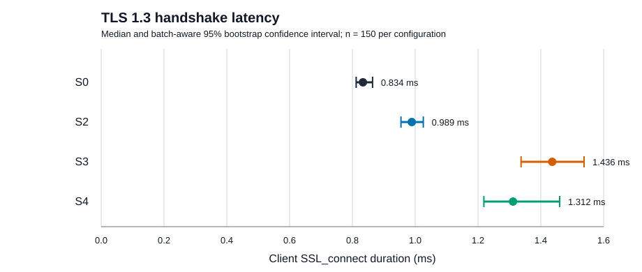
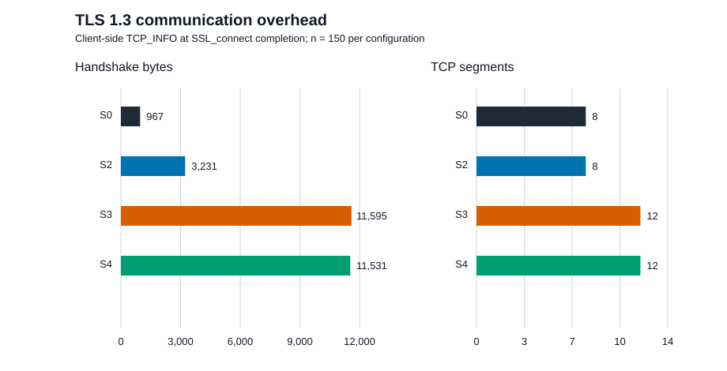
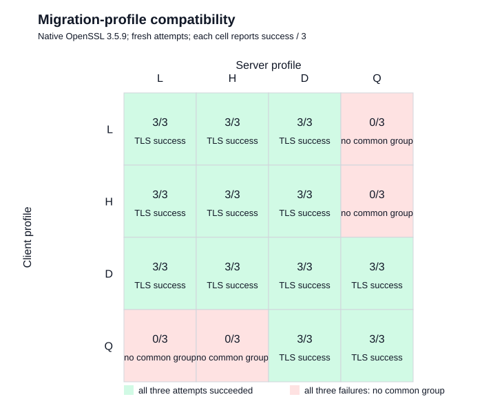
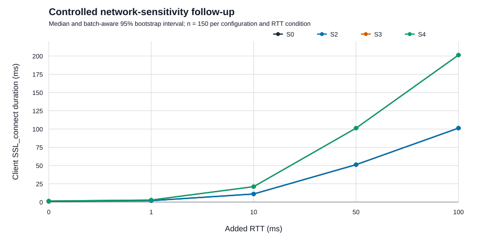

# از کلاسیک تا پساکوانتومی: مطالعه‌ای تجربی دربارهٔ مسیرهای مهاجرت TLS، سربار کارایی و سازگاری

## ۵ روش‌شناسی

### ۵.۱ طراحی مطالعه و دامنهٔ تحلیلی

این پژوهش یک مطالعهٔ موردی تجربی و کنترل‌شده دربارهٔ پیکربندی‌های منتخب TLS
1.3 در OpenSSL بومی است. رفتار پیکربندی و رفتار مسیر مهاجرت، دو واحد تحلیلی
متمایز در نظر گرفته شده‌اند. زمان دست‌دهی تازه (fresh handshake)، شاخص‌های
ارتباطی، شاخص‌های مصرف منابع، و نتیجهٔ دست‌دهی‌های هم‌پیکربندی به خودِ
پیکربندی نسبت داده می‌شوند؛ در مقابل، تغییرات پیکربندی و سازگاری میان
پروفایل‌ها به‌عنوان ویژگی‌های یک مسیر گذار ثبت می‌شوند. این تفکیک مانع از آن
می‌شود که فعالیت وابسته به تاریخچهٔ مهاجرت، به‌اشتباه هزینهٔ ذاتی یک دست‌دهی
واحد تلقی شود.

آزمایش اصلی روی Ubuntu 26.04.1 بومی و سخت‌افزار Intel Core i5-12450H انجام
شد. OpenSSL 3.5.9 از commit زیر در کد منبع ساخته شد:
`45e844fa2a14ec92d146bd8f5778ac130b6625fb`. دامنهٔ پژوهش عمداً محدود است:
شواهد تنها به پیاده‌سازی پین‌شدهٔ TLS 1.3/OpenSSL، سخت‌افزار و گواهی‌نامه‌های
محلیِ ذکرشده، و رویه‌های کنترل‌شدهٔ زیر مربوط‌اند. این پژوهش برای برآورد
کارایی عمومی رمزنگاری پساکوانتومی (post-quantum cryptography; PQC)،
سازگاری مرورگرها، رفتار زیرساخت کلید عمومی (public-key infrastructure; PKI)
عمومی، یا نتایج استقرار عملیاتی طراحی نشده است.

### ۵.۲ پیکربندی‌های TLS

در تمام حالت‌ها، TLS 1.3 و `TLS_AES_128_GCM_SHA256` به‌طور اجباری انتخاب
شدند. بلیت نشست (session ticket) و cache نشست غیرفعال بودند. هر مشاهده با
یک فرایند client تازه و یک فرایند server تازه که برای پذیرش تنها یک اتصال
پیکربندی شده بود، انجام شد. چهار پیکربندی ارزیابی‌شده در جدول ۱ آمده‌اند.

| حالت | گروه ایجاد کلید | احراز هویت server |
| --- | --- | --- |
| S0 | X25519 | ECDSA P-256 |
| S2 | X25519MLKEM768 | ECDSA P-256 |
| S3 | X25519MLKEM768 | ML-DSA-65 |
| S4 | MLKEM768 | ML-DSA-65 |

**جدول ۱.** پیکربندی‌های TLS 1.3 ارزیابی‌شده.

`X25519MLKEM768` گروه ترکیبی ایجاد کلید (hybrid key establishment) در TLS
1.3 است که در RFC 10024 استاندارد شده است [@RFC10024]. در مقابل، S4 فقط به
عنوان پیکربندیِ پشتیبانی‌شده توسط پیاده‌سازی (implementation-supported) با
MLKEM768/ML-DSA-65 در build پین‌شدهٔ OpenSSL توصیف می‌شود؛ نه برچسب گروه
ترکیبی استاندارد دارد و نه چنین تفسیری از آن ارائه می‌شود. پیش از گردآوری
داده، هر پیکربندی سه دست‌دهی امکان‌سنجی مستقل را با موفقیت گذراند. یک
دست‌دهی فقط وقتی پذیرفته شد که نسخهٔ TLS، cipher suite، گروه مذاکره‌شده، و
طرح امضای CertificateVerify مشاهده‌شده با پیکربندی درخواست‌شده منطبق بودند.

### ۵.۳ کمپین اصلی Ubuntu

کمپین اصلی از پنج batch تشکیل شد. در هر batch، برای هر حالت ده دست‌دهی
گرم‌سازی (warm-up) ثبت‌شده و سپس سی دست‌دهی تازهٔ اندازه‌گیری‌شده اجرا شد.
داده‌های warm-up به‌عنوان رکورد اجرا حفظ شدند، اما در استنباط آماری وارد
نشدند. ۱۲۰ دست‌دهی اندازه‌گیری‌شده در هر batch با استفاده از seed قطعیِ ثبت‌شده
برای همان batch، میان چهار حالت به‌صورت تصادفی مرتب شدند. بنابراین کمپین
نهایی شامل ۲۰۰ warm-up و ۶۰۰ دست‌دهی اندازه‌گیری‌شده، معادل ۱۵۰ مشاهده برای
هر حالت، بود.

client و server به‌ترتیب به CPUهای ۲ و ۴ پین شدند؛ پیش‌تر تأیید شده بود که
این دو هسته، هسته‌های performance متمایز و غیرهم‌خانواده (non-sibling) هستند.
CPU ۰ برای سیستم‌عامل آزاد ماند. سیستم به برق AC متصل بود و profile سیستم و
platform، CPU governor، و energy-performance preference در ابتدا و انتهای هر
batch ملزم به مقدار `performance` بودند. بین batchهای تکمیل‌شده، فاصلهٔ بیکاری
۱۲۰ ثانیه‌ای اعمال شد. برای هر batch، CSV خام، metadata، هویت کد منبع و
پیکربندی، ترتیب برنامه‌ریزی‌شده و ترتیب واقعی اجرا، snapshotهای محیط،
timestampها و اطلاعات یکپارچگی SHA-256 نگهداری شدند.

### ۵.۴ اندازه‌گیری‌ها

متغیر اصلی، مدت دست‌دهی TLS در سمت client بود که به‌صورت فاصلهٔ
`CLOCK_MONOTONIC_RAW` بلافاصله پیرامون `SSL_connect()` تعریف شد. مدت اتصال
TCP به‌صورت مستقل ثبت شد. زمان CPU در client و server به‌صورت تغییرات
per-thread در مجموع زمان user و system، با `getrusage` و در مرزهای نقشِ
مستندشده اندازه‌گیری شد. بیشینهٔ حافظهٔ مقیم (resident-set size; RSS) نیز
مقدار `ru_maxrss` هر فرایند تازه بود.

شاخص‌های ارتباطی در لحظهٔ موفقیت `SSL_connect()` و از شمارنده‌های per-socket
در `TCP_INFO` لینوکس در سمت client به‌دست آمدند: مجموع byteهای payload TCP
ارسال‌شده و دریافت‌شده و تعداد segmentهای TCP مشاهده‌شده. یک smoke check
مستقل با packet capture، این شمارنده‌ها را برای هر چهار حالت اعتبارسنجی کرد.
هیچ payload کاربردی ارسال نشد و بلیت‌های نشست نیز غیرفعال بودند. از این رو،
شاخص‌های ارتباطی مرز تعریف‌شدهٔ دست‌دهی را توصیف می‌کنند؛ بسته‌های close و
headerهای شبکه را شامل نمی‌شوند و برآوردی از زمان انتقال در شبکهٔ خارجی نیستند.

### ۵.۵ تحلیل آماری

تمام مشاهده‌های اندازه‌گیری‌شدهٔ تعریف‌شده در پروتکل و تمام batchهای کامل،
حتی مقدارهای از نظر آماری غیرمعمول، حفظ شدند. latency با median و دامنهٔ
بین‌چارکی (interquartile range; IQR) خلاصه شد؛ میانگین، انحراف معیار، ضریب
تغییرات، P95 و P99 فقط شاخص‌های توصیفی‌اند. فاصله‌های bootstrap صدکی ۹۵٪ اصلی
بر پایهٔ ۲۰٬۰۰۰ بازنمونه‌گیری محاسبه شدند: ابتدا batchها و سپس مشاهده‌های درون
هر batch انتخاب‌شده بازنمونه‌گیری شدند. یک تحلیل حساسیت با batchهای ثابت نیز
مشاهده‌ها را بازنمونه‌گیری کرد و عضویت پنج batch مشاهده‌شده را بدون تغییر نگه
داشت.

تفاوت پیکربندی‌ها برابر با median(حالت) منهای median(S0) و همراه با فاصله‌های
bootstrap آگاه از batch گزارش شد. با وجود تنها پنج batch مشاهده‌شده، این
فاصله‌ها توصیف‌کنندهٔ عدم‌قطعیت کمپین هستند، نه آزمون فرض صفر. متغیرهای
ارتباطی و منابع، شاخص‌های ثانویه‌اند. هیچ مشاهده یا batch کامل صرفاً به‌دلیل
غیرمعمول به‌نظر رسیدن حذف نشد.

### ۵.۶ شواهد مسیر مهاجرت و سازگاری

مهاجرت با توصیف‌کننده‌های گذار ثبت شد، نه با یک امتیاز مصنوعیِ پیچیدگی. گذار
مستقیم S0 به S4 است و گذار مرحله‌ای S0 به S2، سپس S3 و در پایان S4. برای هر
گذار، تغییر در گروه، طرح امضا، مواد گواهی‌نامه و اعتماد (trust material)،
hostname، نیازهای harness/build، رویهٔ اعتبارسنجی، و شواهد دست‌دهی هم‌پیکربندی
ثبت شد. این پژوهش نیروی کار انسانی، عملیات PKI، سازگاری نسخه‌های متفاوت،
رفتار rollback، یا ریسک استقرار عملیاتی را برآورد نکرد.

یک مطالعهٔ پیگیری مستقل، چهار profile را بررسی کرد: legacy (L)، گذار ایجاد
کلید ترکیبی (hybrid-key-establishment transition; H)، گذار دوقابلیتی
(dual-capable transition; D)، و PQ سخت‌گیرانه (strict PQ; Q). پیش از اجرای
matrix، یک server context واحد در OpenSSL بومی که certificate-selection
callback داشت، باید انتخاب ECDSA P-256 برای client نوع L و انتخاب ML-DSA-65
برای client نوع D را نشان می‌داد. این gate از گواهی‌نامه‌های آزمایشی محلی و
تازه، TLS 1.3 و همان build پین‌شدهٔ OpenSSL استفاده کرد.

پس از عبور gate، هر زوج مرتب‌شدهٔ client/server سه بار و با ترتیب تصادفیِ
ثبت‌شده آزمایش شد؛ در نتیجه ۴۸ تلاش تازه انجام شد. matrix پارامترهای
مذاکره‌شده، انتخاب گواهی‌نامه، نتایج اعتبارسنجی و اطلاعات پالایش‌شدهٔ شکست را
حفظ کرد، اما دادهٔ عملکرد گردآوری نکرد. صرف اتصال TCP برای موفقیت کافی نبود:
موفقیت به تکمیل TLS، اعتبارسنجی زنجیرهٔ گواهی‌نامه و اعتبارسنجی hostname نیاز
داشت.

### ۵.۷ مطالعهٔ پیگیری اعتبارسنجی جهت‌دار در Windows

یک کمپین مستقل در Windows 11 بومی، از همان سخت‌افزار Intel Core i5-12450H،
همان commit کد منبع OpenSSL، نسخهٔ TLS، cipher suite، چهار پیکربندی، طراحی
فرایندهای تازه و ساختار پنج-batch استفاده کرد. client در Windows فاصلهٔ
`SSL_connect()` را با QueryPerformanceCounter اندازه‌گیری کرد. پیش از
گردآوری، workflow به برق AC، طرح `High performance` که صریحاً انتخاب شده بود،
گواهی‌نامه‌های محلی معتبر، هویت پین‌شدهٔ OpenSSL، و دو هستهٔ performance-class
فعال و غیرهم‌خانواده نیاز داشت. هم‌چنین affinity فرایند، اعتبار پیکربندی و
snapshotهای محیط را پیش و پس از هر batch ثبت کرد.

تحلیل Windows همان رویکرد median، IQR و bootstrap صدکیِ ۲۰٬۰۰۰ بازنمونه‌ای و
آگاه از batch را به‌کار گرفت. نقش آن کیفی بود: بررسی این‌که جهت هر تفاوت S0
درون Windows با جهت مشاهده‌شده در Ubuntu مطابقت دارد یا خیر. مجموعه‌داده‌های
Windows و Ubuntu با هم ادغام نشدند و طراحی مطالعه، تفاوت مطلق latency میان
Windows و Ubuntu یا اثر سیستم‌عامل را برآورد نمی‌کند. شاخص‌های اختصاصی لینوکس
`TCP_INFO` و `getrusage` در Windows تکرار نشدند.

### ۵.۸ مطالعهٔ پیگیری حساسیت کنترل‌شدهٔ شبکه

یک مطالعهٔ پیگیری مستقل در Ubuntu بومی، همان چهار پیکربندی را در پنج وضعیت
ازپیش‌تعریف‌شدهٔ RTT افزوده ارزیابی کرد: ۰، ۱، ۱۰، ۵۰ و ۱۰۰ ms. دو network
namespace اختصاصی لینوکس با یک جفت veth به هم متصل شدند. تأخیر خروجیِ متقارن
(symmetric egress delay) با `tc netem` بر هر دو endpoint اعمال شد، به‌گونه‌ای
که مجموع دو تأخیر یک‌طرفه برابر RTT اعلام‌شده باشد. وضعیت ۰ ms یک کنترل
topology است، نه تکرار آزمایش loopback اصلی.

هر وضعیت پنج batch تصادفی داشت. هر batch شامل ده warm-up حفظ‌شده و سی
دست‌دهی تازهٔ اندازه‌گیری‌شده برای هر حالت بود؛ در نتیجه برای هر حالت و هر
وضعیت، ۱۵۰ مشاهدهٔ اندازه‌گیری‌شده به‌دست آمد. تمام ۲۵ condition-batch به‌صورت
تصادفی مرتب شدند. workflow پیش و پس از هر batch، topology namespace، وضعیت
qdisc، اعتبار گواهی‌نامهٔ محلی، هویت OpenSSL، برق AC و همان guardهای affinity و
performance در کمپین اصلی را اعتبارسنجی کرد.

تحلیل شبکه تمام ۳٬۰۰۰ مشاهدهٔ اندازه‌گیری‌شده را حفظ کرد و از همان طراحی
bootstrap آگاه از batch، به‌صورت جداگانه برای هر وضعیت، استفاده کرد. وضعیت‌های
RTT با هم ادغام نشدند. این setup، packet loss، محدودیت پهنای باند، jitter،
congestion، بازمرتب‌سازی (reordering)، مرورگرها، PKI عمومی یا یک مسیر اینترنتی
را شبیه‌سازی نکرد.

## ۶ نتایج

### ۶.۱ یکپارچگی و اعتبارسنجی کمپین اصلی

کمپین نهایی Ubuntu هر پنج batch برنامه‌ریزی‌شده را تکمیل کرد و ۸۰۰ ردیف تولید
شد: ۲۰۰ warm-up ثبت‌شده و ۶۰۰ دست‌دهی اندازه‌گیری‌شده. تحلیل، تمام ۶۰۰ مشاهدهٔ
اندازه‌گیری‌شده را نگه داشت که برای هر پیکربندی ۱۵۰ مشاهده بود. هر ۸۰۰ دست‌دهی
موفق بودند. در تمام رکوردها، نسخهٔ مشاهده‌شده TLS 1.3، cipher suite برابر
`TLS_AES_128_GCM_SHA256`، و گروه مذاکره‌شده و طرح امضای CertificateVerify با
حالت درخواست‌شده منطبق بود. هش هر CSV خام با metadata ثبت‌شدهٔ همان batch
مطابقت داشت. guardهای برق AC، profile سیستم، profile پلتفرم، CPU governor،
energy-performance preference و CPU affinity نیز در آغاز و پایان هر batch
موفق بودند.

### ۶.۲ latency دست‌دهی اصلی

جدول ۲ مدت `SSL_connect()` را در سمت client و در کمپین loopback اصلی Ubuntu
نشان می‌دهد. median حالت S0 برابر ۰٫۸۳۴ ms بود. medianهای متناظر برای S2، S3
و S4 به‌ترتیب ۰٫۹۸۹، ۱٫۴۳۶ و ۱٫۳۱۲ ms بودند. نسبت به S0، تفاوت‌های median
آگاه از batch برای S2 برابر ۰٫۱۵۶+ ms، برای S3 برابر ۰٫۶۰۳+ ms و برای S4
برابر ۰٫۴۷۸+ ms بود. فاصلهٔ هر سه تفاوت، صفر را دربر نمی‌گرفت.

| حالت | n | median (ms) | فاصلهٔ bootstrap ۹۵٪ | IQR (ms) | تفاوت با S0 (ms) | فاصلهٔ ۹۵٪ تفاوت |
| --- | ---: | ---: | --- | ---: | ---: | --- |
| S0 | 150 | 0.834 | [0.812, 0.864] | 0.114 | 0.000 | [0.000, 0.000] |
| S2 | 150 | 0.989 | [0.955, 1.026] | 0.137 | +0.156 | [+0.115, +0.203] |
| S3 | 150 | 1.436 | [1.337, 1.538] | 0.642 | +0.603 | [+0.501, +0.700] |
| S4 | 150 | 1.312 | [1.219, 1.460] | 0.663 | +0.478 | [+0.383, +0.621] |

**جدول ۲.** نتایج latency در Ubuntu اصلی. فاصله‌ها از bootstrap صدکیِ آگاه از
batch با ۲۰٬۰۰۰ بازنمونه‌گیری به‌دست آمده‌اند.

جهت هر تفاوت غیرکلاسیک در هر پنج batch حفظ‌شده مثبت بود. دامنهٔ تفاوت‌های
مشاهده‌شده در سطح batch برای S2 برابر ۰٫۱۱۶+ تا ۰٫۲۲۶+ ms، برای S3 برابر
۰٫۴۹۶+ تا ۰٫۶۵۳+ ms و برای S4 برابر ۰٫۳۸۰+ تا ۰٫۵۴۶+ ms بود. هیچ مشاهدهٔ
اندازه‌گیری‌شده یا batch تکمیل‌شده‌ای از این تحلیل حذف نشد.

### ۶.۳ شاخص‌های ارتباطی و منابع

جدول ۳ شاخص‌های ثانویه‌ای را نشان می‌دهد که در مرز تعریف‌شدهٔ دست‌دهی
اندازه‌گیری شدند. median زمان اتصال TCP برای تمام حالت‌ها ۰٫۰۴۵ ms بود. S2
نسبت به S0 byteهای payload بیشتری در دست‌دهی ارسال و دریافت کرد، اما median
تعداد segment آن همچنان هشت بود. S3 و S4 median byteهای payload و تعداد
segment بالاتری داشتند. مقادیر CPU و RSS به‌عنوان شاخص‌های per-process گزارش
شده‌اند، نه برآورد کل منابع سیستم.

| حالت | median byteهای دست‌دهی | median segmentهای TCP | median CPU client (ms) | median CPU server (ms) | اوج RSS هر فرایند (KiB) |
| --- | ---: | ---: | ---: | ---: | ---: |
| S0 | 967 | 8 | 0.696 | 0.409 | 21,916 |
| S2 | 3,231 | 8 | 0.655 | 0.475 | 21,916 |
| S3 | 11,595 | 12 | 0.910 | 0.996 | 21,916 |
| S4 | 11,531 | 12 | 0.819 | 0.891 | 21,916 |

**جدول ۳.** شاخص‌های ارتباطی و منابع در Ubuntu اصلی.

### ۶.۴ سازگاری مسیر مهاجرت

در harness پارامتری‌شده، گذار مرحله‌ای از S0 به S2 فقط گروه را تغییر می‌دهد؛
گذار S2 به S3 احراز هویت و مواد متناظر گواهی‌نامه/اعتماد و hostname را تغییر
می‌دهد؛ و گذار S3 به S4 فقط گروه را تغییر می‌دهد. گذار مستقیم S0 به S4 تغییرات
گروه و احراز هویت/گواهی‌نامه را با هم ترکیب می‌کند. در محیط پین‌شده، میان این
حالت‌ها به تغییر کد منبع یا build نیاز نبود.

gate سازگاری تأیید کرد که یک server context، گواهی‌نامهٔ ECDSA P-256 را برای
client نوع L و گواهی‌نامهٔ ML-DSA-65 را برای client نوع D انتخاب کرد؛ هر دو
دست‌دهی gate، اعتبارسنجی زنجیره و hostname در TLS 1.3 را کامل کردند. matrix
بعدی ۴×۴، ۴۸ تلاش تازه، یعنی سه تلاش برای هر زوج مرتب‌شدهٔ client/server، را
حفظ کرد. ۳۶ تلاش موفق و ۱۲ تلاش ناموفق بودند. تمام شکست‌ها پیش از
اعتبارسنجی گواهی‌نامه با `NO_COMMON_GROUP` ثبت شدند.

| Client \ Server | L | H | D | Q |
| --- | ---: | ---: | ---: | ---: |
| L | 3/3 | 3/3 | 3/3 | 0/3 |
| H | 3/3 | 3/3 | 3/3 | 0/3 |
| D | 3/3 | 3/3 | 3/3 | 3/3 |
| Q | 0/3 | 0/3 | 3/3 | 3/3 |

**جدول ۴.** تعداد تلاش‌های موفق برای هر زوج مرتب‌شدهٔ profileهای client/server.
هر خانه شامل سه تلاش تازهٔ حفظ‌شده است.

در این پیاده‌سازی محلی، D با تمام profileهای ارزیابی‌شده کامل شد؛ مسیر ECDSA
را با L و H حفظ کرد و با Q مسیر ML-DSA-65/MLKEM768 را مذاکره کرد.

### ۶.۵ مطالعهٔ پیگیری اعتبارسنجی جهت‌دار در Windows

کمپین مستقل Windows پنج batch برنامه‌ریزی‌شده را تکمیل و ۶۰۰ دست‌دهی
اندازه‌گیری‌شده، دوباره ۱۵۰ مشاهده برای هر حالت، را حفظ کرد. تمام ۸۰۰ ردیف
ثبت‌شده، شامل ۲۰۰ warm-up، اعتبار بازگشت فرایند، TLS، cipher، گروه، احراز
هویت، زنجیرهٔ گواهی‌نامه، hostname و affinity را با موفقیت گذراندند. جدول ۵
فقط نتایج درون Windows را نشان می‌دهد. در هر پنج batch Windows، هر
پیکربندی غیرکلاسیک تفاوت median مثبتی نسبت به S0 داشت.

| حالت | n | median (ms) | فاصلهٔ bootstrap ۹۵٪ | تفاوت با S0 (ms) | فاصلهٔ ۹۵٪ تفاوت |
| --- | ---: | ---: | --- | ---: | --- |
| S0 | 150 | 1.439 | [1.411, 1.470] | 0.000 | [0.000, 0.000] |
| S2 | 150 | 1.783 | [1.735, 1.851] | +0.344 | [+0.294, +0.406] |
| S3 | 150 | 2.088 | [1.955, 2.227] | +0.649 | [+0.507, +0.788] |
| S4 | 150 | 1.912 | [1.819, 2.055] | +0.473 | [+0.369, +0.631] |

**جدول ۵.** نتایج latency درون Windows. این زمان‌ها با مشاهده‌های Ubuntu ادغام
نشده‌اند.

هر سه تفاوت در هر پنج batch Ubuntu نیز مثبت بودند. بنابراین، دو کمپین در جهت
تفاوت‌های درون‌پلتفرمی نسبت به S0 توافق دارند. محیط‌های زمان‌سنجی دو مجموعه‌داده
متمایزند و جداگانه گزارش می‌شوند؛ این نتیجه تفاوت مطلق latency میان Windows و
Ubuntu را برآورد نمی‌کند.

### ۶.۶ مطالعهٔ پیگیری حساسیت کنترل‌شدهٔ شبکه

کمپین مستقل namespace/veth/netem هر ۲۵ batch برنامه‌ریزی‌شده را تکمیل کرد:
پنج batch در هر وضعیت RTT افزوده. این کمپین ۱٬۰۰۰ warm-up را حفظ و ۳٬۰۰۰
دست‌دهی تازهٔ اندازه‌گیری‌شده، یعنی ۱۵۰ مشاهده برای هر حالت و هر وضعیت، را
تحلیل کرد. هر ۴٬۰۰۰ دست‌دهی موفق بودند و guardهای OpenSSL، TLS، گواهی‌نامه،
محیط، affinity و qdisc پیش و پس از هر batch با موفقیت گذراندند.

جدول ۶ medianهای وابسته به وضعیت و تفاوت median نسبت به S0 را نشان می‌دهد.
تمام تفاوت‌های S2، S3 و S4 در هر پنج batchِ همان وضعیت، مثبت بودند. در RTT
افزودهٔ ۱۰، ۵۰ و ۱۰۰ ms، تفاوت S2 کمتر از ۰٫۲ ms ماند، درحالی‌که تفاوت‌های S3
و S4 به RTT افزودهٔ اعلام‌شده نزدیک بودند.

| RTT افزوده | median S0 (ms) | median S2؛ تفاوت (ms) | median S3؛ تفاوت (ms) | median S4؛ تفاوت (ms) |
| ---: | ---: | ---: | ---: | ---: |
| 0 ms | 0.830 | 0.996؛ +0.166 | 1.446؛ +0.615 | 1.391؛ +0.560 |
| 1 ms | 1.897 | 2.019؛ +0.123 | 2.812؛ +0.916 | 2.707؛ +0.811 |
| 10 ms | 11.021 | 11.162؛ +0.141 | 21.116؛ +10.095 | 21.035؛ +10.014 |
| 50 ms | 51.118 | 51.313؛ +0.195 | 101.260؛ +50.141 | 101.179؛ +50.061 |
| 100 ms | 101.224 | 101.351؛ +0.127 | 201.305؛ +100.081 | 201.214؛ +99.990 |

**جدول ۶.** نتایج حساسیت شبکه برای هر وضعیت. هر خانه ۱۵۰ مشاهدهٔ
اندازه‌گیری‌شده را خلاصه می‌کند و وضعیت‌ها جداگانه تحلیل شده‌اند.

در پنج وضعیت، median byteهای دست‌دهی در سمت client نزدیک به ۹۹۶ برای S0،
۳۲۶۰ برای S2، ۱۱٬۶۲۳ برای S3 و ۱۱٬۵۵۹ برای S4 باقی ماند. در RTT افزودهٔ ۱۰
تا ۱۰۰ ms، تعداد median segmentهای TCP به‌ترتیب ۸، ۹، ۱۹ و ۱۹ بود. این‌ها
شاخص‌های ثبت‌شدهٔ harness کنترل‌شده‌اند، نه تجزیهٔ علّی تفاوت‌های latency
مشاهده‌شده.
