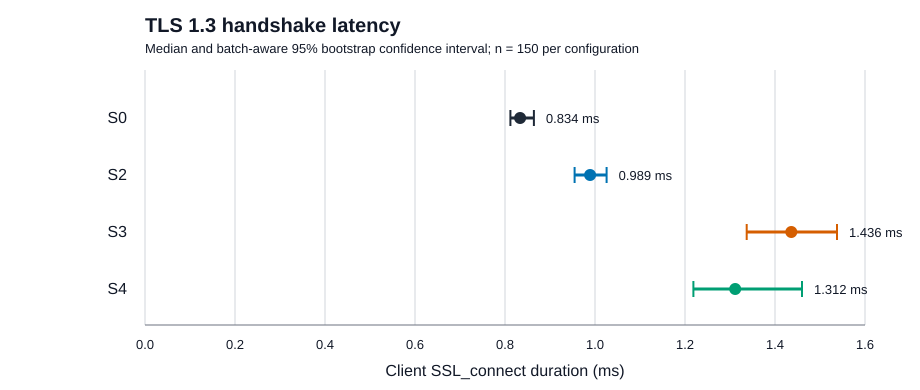
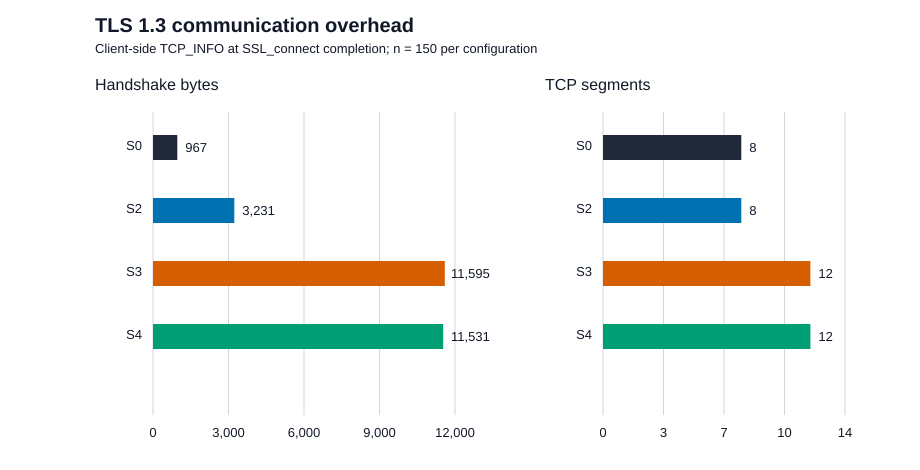

# 7 Results

## 7.1 Dataset integrity and configuration validation

The final Ubuntu campaign completed all five planned batches. It produced 800
rows: 200 warm-ups and 600 measured handshakes. The analysis includes the 600
measured observations, comprising 150 per configuration. All 800 handshakes
succeeded. In every row, the negotiated TLS version was TLS 1.3, the cipher
suite was `TLS_AES_128_GCM_SHA256`, and the negotiated group and signature
scheme matched the requested configuration. The recorded CSV hashes matched
their batch metadata.

All batch-start and batch-end environment guards passed. AC remained online;
system and platform profiles, governor, and energy-performance preference were
`performance`; and the client/server affinities remained CPUs 2 and 4.

## 7.2 Handshake latency

Figure 1 shows the median client `SSL_connect()` duration and batch-aware 95%
bootstrap intervals. S0 had a median of 0.834 ms. The corresponding medians
were 0.989 ms for S2, 1.436 ms for S3, and 1.312 ms for S4. Relative to S0,
the median contrasts were +0.156 ms for S2 (95% CI [+0.115, +0.203]), +0.603
ms for S3 ([+0.501, +0.700]), and +0.478 ms for S4 ([+0.383, +0.621]).

The same direction appeared in each of the five batches. S2 contrasts ranged
from +0.116 to +0.226 ms, S3 contrasts from +0.496 to +0.653 ms, and S4
contrasts from +0.380 to +0.546 ms. The fixed-batch sensitivity intervals also
excluded zero for all three contrasts. No observation or completed batch was
removed during analysis.

## 7.3 Communication overhead

Figure 2 reports the client-side TCP_INFO values at the `SSL_connect()`
boundary. Median handshake bytes were 967 for S0, 3,231 for S2, 11,595 for
S3, and 11,531 for S4. Median packet counts were eight for S0 and S2, and
twelve for S3 and S4. Median TCP connect time was approximately 0.045 ms for
every configuration.

These values describe loopback handshake payload and segment behavior under
the stated protocol boundary. They do not quantify external-network transfer
time, loss sensitivity, or production application traffic.

## 7.4 Resource descriptors

Median client CPU times were 0.696, 0.655, 0.910, and 0.819 ms for S0, S2,
S3, and S4, respectively. Corresponding server CPU medians were 0.409, 0.475,
0.996, and 0.891 ms. Peak RSS was 21,916 KiB for both fresh client and server
processes in every configuration. These are per-process, run-level descriptors
and do not measure total system memory or production-server resource use.

## 7.5 Migration-path descriptors

Within the parameterized harness, movement from S0 to S2 changes the group
only; S2 to S3 changes authentication, credential/trust material, and hostname;
and S3 to S4 changes the group only. No source-code or build change was needed
between those states in the pinned study environment. The direct S0-to-S4 path
combines the group and authentication/credential changes in one cutover.

These are case-specific configuration descriptors, not a general migration
effort score. The study did not measure mixed-version interoperability, PKI
operations, human labor time, rollback, or production deployment risk.
