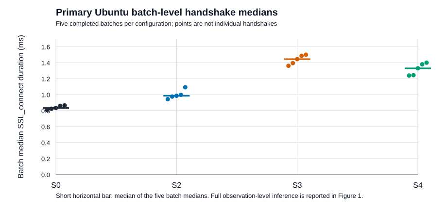
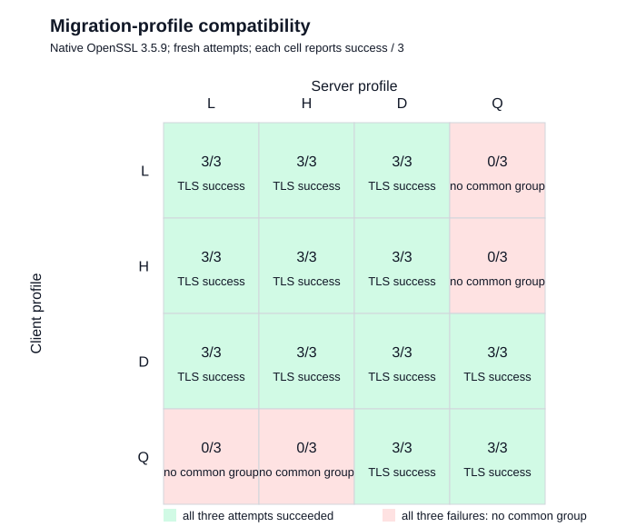

# Supplementary Material

## S1 Scope and use

This supplement provides reproducibility detail for *From Classical to
Post-Quantum: An Empirical Study of TLS Migration Paths, Performance Overhead,
and Compatibility*. It is designed to accompany the main manuscript without
repeating its interpretation. The authoritative raw artifacts, metadata,
checksums, protocols, and analysis scripts are versioned in the project
repository. Supplementary tables identify those artifacts and the boundaries
of the evidence they support.

## S2 Evaluated configuration matrix

| Case | Key-establishment group | Server authentication | Role in the study |
| --- | --- | --- | --- |
| S0 | X25519 | ECDSA P-256 | Classical baseline |
| S2 | X25519MLKEM768 | ECDSA P-256 | Hybrid key establishment with classical authentication |
| S3 | X25519MLKEM768 | ML-DSA-65 | Hybrid key establishment with PQ authentication |
| S4 | MLKEM768 | ML-DSA-65 | Implementation-supported PQ configuration |

All cases forced TLS 1.3 and `TLS_AES_128_GCM_SHA256`, disabled session
tickets and caches, and used fresh client and one-accept server processes.
S4 is not described as an RFC 10024 hybrid group.

## S3 Campaign inventory and inclusion rules

| Evidence stream | Campaign or record | Measured observations | Inclusion rule | Analysis boundary |
| --- | --- | ---: | --- | --- |
| Primary Ubuntu loopback | `campaign-20261020T083014Z-70543371b61f` | 600 | 150 per case; all measured observations retained | One native Ubuntu/OpenSSL loopback study |
| Migration compatibility | `compat-v1-matrix-20261101T140752Z-7ef56e69` | 48 attempts | Every ordered profile pair attempted three times; no retry | Local native-OpenSSL functional evidence |
| Windows direction validation | `campaign-20261109T081504Z-c825d34051ff` | 600 | 150 per case; all measured observations retained | Separate same-device Windows study; not pooled with Ubuntu |
| Network sensitivity | `campaign-20261114T202013Z-44a824c91fb9` | 3,000 | 150 per case and RTT condition; all measured observations retained | Separate namespace/veth/netem study; conditions not pooled |

Warm-ups were retained in raw artifacts but excluded from statistical
inference: 200 in the primary Ubuntu campaign, 200 in the Windows campaign,
and 1,000 in the network campaign. The campaign-level integrity reports and
metadata record all raw-file SHA-256 values.

## S4 Artifact map and reproduction entry points

| Purpose | Versioned repository location |
| --- | --- |
| Primary campaign integrity and analysis | `docs/phase-2/FINAL-CAMPAIGN-INTEGRITY-20261020.md`; `docs/phase-3/FINAL_UBUNTU_ANALYSIS.md` |
| Compatibility protocol and results | `docs/phase-4/PROFILE_COMPATIBILITY_PROTOCOL.md`; `docs/phase-4/PROFILE_COMPATIBILITY_RESULTS.md` |
| Windows integrity and analysis | `docs/windows-validation/FINAL_CAMPAIGN_INTEGRITY_20261109.md`; `docs/windows-validation/FINAL_WINDOWS_ANALYSIS.md` |
| Network protocol and analysis | `docs/network-sensitivity/PROTOCOL.md`; `docs/network-sensitivity/FINAL_NETWORK_ANALYSIS.md` |
| Raw CSVs and metadata | `data/raw/`; `data/metadata/` |
| Main analyses and audits | `scripts/analysis/` |
| Figures and rendering instructions | `manuscript/figures/README.md` |

The analysis scripts validate the recorded data and write derived outputs below
the ignored `data/processed/` directory. They do not modify raw campaign data.
Before reproducing a campaign, readers should consult the corresponding
protocol, environment manifest, and integrity record rather than inferring
runtime settings from a derived result alone.

## S5 Supplementary figures

Supplementary Figure S1 shows the retained primary-Ubuntu batch medians. It is
a stability view and does not replace observation-level, batch-aware inference.

Supplementary Figure S2 presents the local 4-by-4 compatibility matrix. Each
cell represents three retained fresh attempts; it is not browser or public-PKI
interoperability evidence.

## S6 Material intentionally excluded

Private keys, locally generated certificates, machine-local build products,
packet captures, and machine-specific credentials are excluded from the
repository. Their exclusion protects sensitive or nonportable artifacts and
does not remove any reported measured observation, metadata record, or
integrity value. The main manuscript and repository documentation identify the
controls and validation procedures used in their place.
