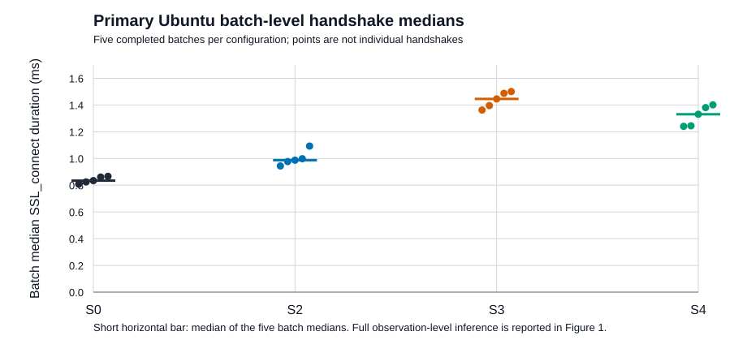
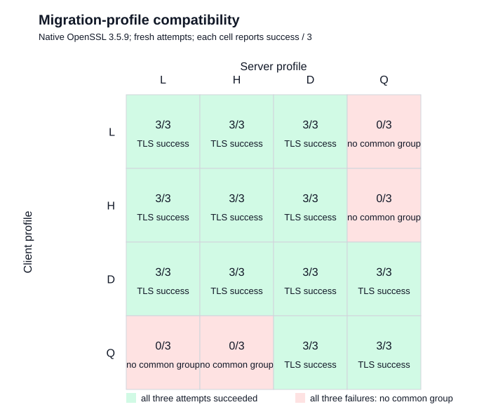

# مواد تکمیلی

## S1 دامنه و نحوهٔ استفاده

این مواد تکمیلی، جزئیات بازتولیدپذیری مقالهٔ «از کلاسیک تا پساکوانتومی:
مطالعه‌ای تجربی دربارهٔ مسیرهای مهاجرت TLS، سربار کارایی و سازگاری» را ارائه
می‌کنند. هدف آن‌ها همراهی با متن اصلی، بدون تکرار تفسیرهای مقاله است. artifactهای
خامِ مرجع، metadata، checksumها، پروتکل‌ها و اسکریپت‌های تحلیل در repository
پروژه نسخه‌بندی شده‌اند. جدول‌های تکمیلی، این artifactها و محدودهٔ شواهدی را که
پشتیبانی می‌کنند مشخص می‌سازند.

## S2 ماتریس پیکربندی‌های ارزیابی‌شده

| حالت | گروه ایجاد کلید | احراز هویت server | نقش در پژوهش |
| --- | --- | --- | --- |
| S0 | X25519 | ECDSA P-256 | خط پایهٔ کلاسیک |
| S2 | X25519MLKEM768 | ECDSA P-256 | ایجاد کلید ترکیبی با احراز هویت کلاسیک |
| S3 | X25519MLKEM768 | ML-DSA-65 | ایجاد کلید ترکیبی با احراز هویت PQ |
| S4 | MLKEM768 | ML-DSA-65 | پیکربندی PQ پشتیبانی‌شده توسط پیاده‌سازی |

تمام حالت‌ها TLS 1.3 و `TLS_AES_128_GCM_SHA256` را اجباری کردند، بلیت و cache
نشست را غیرفعال کردند و از فرایندهای client تازه و server با یک پذیرش اتصال
استفاده کردند. S4 به‌عنوان گروه ترکیبی RFC 10024 توصیف نشده است.

## S3 فهرست کمپین‌ها و قواعد ورود داده

| جریان شواهد | کمپین یا رکورد | مشاهده‌های اندازه‌گیری‌شده | قاعدهٔ ورود | مرز تحلیل |
| --- | --- | ---: | --- | --- |
| loopback اصلی Ubuntu | `campaign-20261020T083014Z-70543371b61f` | 600 | ۱۵۰ مورد برای هر حالت؛ همهٔ مشاهده‌های اندازه‌گیری‌شده حفظ شدند | یک مطالعهٔ loopback بومی Ubuntu/OpenSSL |
| سازگاری مهاجرت | `compat-v1-matrix-20261101T140752Z-7ef56e69` | 48 تلاش | هر زوج profile مرتب‌شده سه بار؛ بدون retry | شواهد عملکردی محلی در OpenSSL بومی |
| اعتبارسنجی جهت‌دار Windows | `campaign-20261109T081504Z-c825d34051ff` | 600 | ۱۵۰ مورد برای هر حالت؛ همهٔ مشاهده‌های اندازه‌گیری‌شده حفظ شدند | مطالعهٔ مستقل Windows روی همان دستگاه؛ بدون ادغام با Ubuntu |
| حساسیت شبکه | `campaign-20261114T202013Z-44a824c91fb9` | 3,000 | ۱۵۰ مورد برای هر حالت و هر RTT؛ همهٔ مشاهده‌های اندازه‌گیری‌شده حفظ شدند | مطالعهٔ مستقل namespace/veth/netem؛ وضعیت‌ها ادغام نشدند |

warm-upها در artifactهای خام حفظ شده و از استنباط آماری کنار گذاشته شدند: ۲۰۰
مورد در کمپین اصلی Ubuntu، ۲۰۰ مورد در Windows و ۱٬۰۰۰ مورد در کمپین شبکه.
گزارش‌های یکپارچگی و metadata هر کمپین، تمام مقادیر SHA-256 فایل‌های خام را ثبت
می‌کنند.

## S4 نقشهٔ artifactها و نقاط شروع بازتولید

| هدف | مسیر نسخه‌بندی‌شده در repository |
| --- | --- |
| یکپارچگی و تحلیل کمپین اصلی | `docs/phase-2/FINAL-CAMPAIGN-INTEGRITY-20261020.md`؛ `docs/phase-3/FINAL_UBUNTU_ANALYSIS.md` |
| پروتکل و نتایج سازگاری | `docs/phase-4/PROFILE_COMPATIBILITY_PROTOCOL.md`؛ `docs/phase-4/PROFILE_COMPATIBILITY_RESULTS.md` |
| یکپارچگی و تحلیل Windows | `docs/windows-validation/FINAL_CAMPAIGN_INTEGRITY_20261109.md`؛ `docs/windows-validation/FINAL_WINDOWS_ANALYSIS.md` |
| پروتکل و تحلیل شبکه | `docs/network-sensitivity/PROTOCOL.md`؛ `docs/network-sensitivity/FINAL_NETWORK_ANALYSIS.md` |
| CSVهای خام و metadata | `data/raw/`؛ `data/metadata/` |
| تحلیل‌ها و auditهای اصلی | `scripts/analysis/` |
| شکل‌ها و دستورهای تولید | `manuscript/figures/README.md` |

اسکریپت‌های تحلیل، داده‌های ثبت‌شده را اعتبارسنجی می‌کنند و خروجی‌های مشتق‌شده را
فقط زیر درخت ignoredِ `data/processed/` می‌نویسند. این اسکریپت‌ها دادهٔ خام
کمپین را تغییر نمی‌دهند. پیش از بازتولید یک کمپین، خواننده باید protocol،
environment manifest و integrity record مربوط را بررسی کند و تنظیمات زمان اجرا
را صرفاً از خروجی‌های مشتق‌شده استنباط نکند.

## S5 شکل‌های تکمیلی

شکل تکمیلی S1 medianهای batchهای حفظ‌شده در Ubuntu اصلی را نشان می‌دهد. این
شکل نمای پایداری است و جایگزین استنباط آگاه از batch در سطح مشاهده نیست.

شکل تکمیلی S2 ماتریس سازگاری محلی ۴×۴ را نمایش می‌دهد. هر خانه سه تلاش تازهٔ
حفظ‌شده را نشان می‌دهد؛ این شکل شاهدی برای سازگاری مرورگر یا PKI عمومی نیست.

## S6 مواد عمداً حذف‌شده

کلیدهای خصوصی، گواهی‌نامه‌های تولیدشدهٔ محلی، محصولات build محلی، packet
captureها و credentialهای وابسته به ماشین از repository حذف شده‌اند. حذف این
موارد از artifactهای حساس یا غیرقابل‌انتقال محافظت می‌کند و هیچ مشاهدهٔ
اندازه‌گیری‌شده، رکورد metadata یا مقدار یکپارچگی گزارش‌شده را کنار نمی‌گذارد.
متن اصلی و مستندات repository، کنترل‌ها و رویه‌های اعتبارسنجی به‌کاررفته به‌جای
آن‌ها را مشخص می‌کنند.
